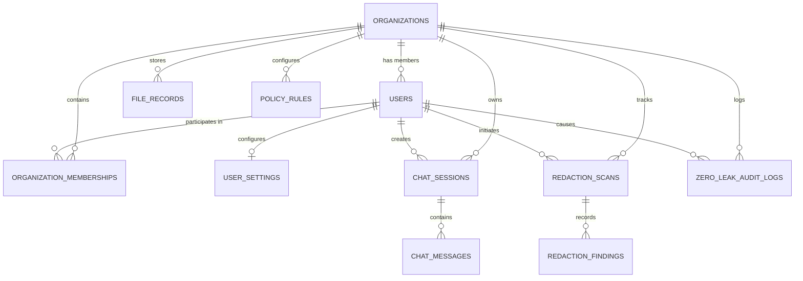

# ZeroLeak AI — Neon PostgreSQL & Drizzle ORM Database Schema

## 1. Overview & Data Privacy Guarantees
The ZeroLeak database layer is implemented using **Drizzle ORM** with **Neon PostgreSQL**. 
Strict compliance rules are enforced at the schema and repository levels:
- **Zero Raw Secret Storage**: Raw prompt text containing secrets, API keys, private keys, database passwords, and unmasked document contents are NEVER stored in any database table.
- **Metadata-Only Audit Logs**: The `zero_leak_audit_logs` table records only operational telemetry (request IDs, provider, model, detection counts, latency, and enforcement outcomes).
- **Sanitized Chat History**: When chat history persistence is enabled, only the post-redaction, sanitized message text is written to `chat_messages`.
- **Tenant Isolation**: Every resource belongs to an `organization_id` and is strictly filtered in database queries.

---

## 2. Entity Relational Diagram (ERD)

---

## 3. Detailed Table Specifications

### 1. `organizations`
- `id` (VARCHAR(64), Primary Key)
- `name` (VARCHAR(255), Not Null)
- `created_at` (TIMESTAMP, Default Now())
- `updated_at` (TIMESTAMP, Default Now())

### 2. `users`
- `id` (VARCHAR(64), Primary Key)
- `email` (VARCHAR(255), Unique, Not Null)
- `display_name` (VARCHAR(255), Not Null)
- `password_hash` (VARCHAR(255), Not Null)
- `role` (VARCHAR(50), Default 'developer')
- `created_at` (TIMESTAMP, Default Now())
- `updated_at` (TIMESTAMP, Default Now())

### 3. `organization_memberships`
- `id` (VARCHAR(64), Primary Key)
- `organization_id` (VARCHAR(64), Foreign Key -> organizations.id, ON DELETE CASCADE)
- `userId` (VARCHAR(64), Foreign Key -> users.id, ON DELETE CASCADE)
- `role` (VARCHAR(50), Default 'developer')
- `created_at` (TIMESTAMP, Default Now())

### 4. `redaction_scans`
- `id` (VARCHAR(64), Primary Key)
- `organization_id` (VARCHAR(64), Foreign Key -> organizations.id, ON DELETE CASCADE)
- `userId` (VARCHAR(64), Foreign Key -> users.id, ON DELETE CASCADE)
- `request_id` (VARCHAR(128), Not Null)
- `input_type` (VARCHAR(50), Not Null) — `'prompt' | 'code' | 'file'`
- `status` (VARCHAR(50), Not Null) — `'clean' | 'sanitized' | 'blocked' | 'failed'`
- `detected_count` (INTEGER, Default 0)
- `redacted_count` (INTEGER, Default 0)
- `blocked_count` (INTEGER, Default 0)
- `policy_version` (VARCHAR(50), Default 'v2.4')
- `processing_duration_ms` (INTEGER, Default 0)
- `created_at` (TIMESTAMP, Default Now())

### 5. `redaction_findings`
- `id` (VARCHAR(64), Primary Key)
- `scan_id` (VARCHAR(64), Foreign Key -> redaction_scans.id, ON DELETE CASCADE)
- `entity_type` (VARCHAR(100), Not Null) — e.g. `'AWS_ACCESS_KEY'`
- `confidence` (REAL, Default 1.0)
- `severity` (VARCHAR(50), Not Null) — `'critical' | 'high' | 'medium' | 'low'`
- `action` (VARCHAR(50), Not Null) — `'mask' | 'block' | 'warn' | 'allow'`
- `masked_preview` (VARCHAR(255)) — Safe synthetic preview (e.g. `'AKI••••••••MPLE'`)
- `occurrence_count` (INTEGER, Default 1)
- `created_at` (TIMESTAMP, Default Now())

### 6. `chat_sessions`
- `id` (VARCHAR(64), Primary Key)
- `organization_id` (VARCHAR(64), Foreign Key -> organizations.id, ON DELETE CASCADE)
- `userId` (VARCHAR(64), Foreign Key -> users.id, ON DELETE CASCADE)
- `title` (VARCHAR(255), Not Null)
- `provider` (VARCHAR(100), Default 'Google Gemini')
- `model` (VARCHAR(100), Default 'gemini-2.5-flash')
- `created_at` (TIMESTAMP, Default Now())
- `updated_at` (TIMESTAMP, Default Now())

### 7. `chat_messages`
- `id` (VARCHAR(64), Primary Key)
- `session_id` (VARCHAR(64), Foreign Key -> chat_sessions.id, ON DELETE CASCADE)
- `role` (VARCHAR(50), Not Null) — `'user' | 'assistant' | 'system'`
- `sanitized_content` (TEXT, Not Null) — **Sanitized text only**
- `status` (VARCHAR(50), Default 'clean') — `'clean' | 'redacted' | 'blocked' | 'safe_response'`
- `created_at` (TIMESTAMP, Default Now())

### 8. `zero_leak_audit_logs`
- `id` (VARCHAR(64), Primary Key)
- `organization_id` (VARCHAR(64), Foreign Key -> organizations.id, ON DELETE CASCADE)
- `userId` (VARCHAR(64), Foreign Key -> users.id, ON DELETE CASCADE)
- `request_id` (VARCHAR(128), Not Null)
- `operation` (VARCHAR(100), Not Null) — `'INSPECT' | 'REDACT' | 'AI_CHAT' | 'FILE_SCAN'`
- `provider` (VARCHAR(100), Default 'Google Gemini')
- `model` (VARCHAR(100), Default 'gemini-2.5-flash')
- `detected_count` (INTEGER, Default 0)
- `redacted_count` (INTEGER, Default 0)
- `policy_action` (VARCHAR(50), Not Null)
- `outcome` (VARCHAR(50), Not Null) — `'Passed' | 'Sanitized' | 'Blocked' | 'Failed'`
- `latency_ms` (INTEGER, Default 0)
- `created_at` (TIMESTAMP, Default Now())

### 9. `user_settings`
- `id` (VARCHAR(64), Primary Key)
- `userId` (VARCHAR(64), Foreign Key -> users.id, Unique, ON DELETE CASCADE)
- `default_provider` (VARCHAR(100), Default 'Google Gemini')
- `default_model` (VARCHAR(100), Default 'gemini-2.5-flash')
- `redaction_policy` (VARCHAR(50), Default 'mask_reversible')
- `history_enabled` (BOOLEAN, Default true)
- `created_at` (TIMESTAMP, Default Now())
- `updated_at` (TIMESTAMP, Default Now())

### 10. `file_records`
- `id` (VARCHAR(64), Primary Key)
- `organization_id` (VARCHAR(64), Foreign Key -> organizations.id, ON DELETE CASCADE)
- `userId` (VARCHAR(64), Foreign Key -> users.id, ON DELETE CASCADE)
- `original_filename` (VARCHAR(255), Not Null)
- `sanitized_filename` (VARCHAR(255), Not Null)
- `mime_type` (VARCHAR(100), Not Null)
- `size_bytes` (INTEGER, Default 0)
- `status` (VARCHAR(50), Not Null) — `'clean' | 'redacted' | 'blocked' | 'error'`
- `detected_count` (INTEGER, Default 0)
- `redacted_count` (INTEGER, Default 0)
- `storage_path` (VARCHAR(500), Not Null)
- `sanitized_storage_path` (VARCHAR(500))
- `sha256_hash` (VARCHAR(64), Not Null)
- `created_at` (TIMESTAMP, Default Now())

### 11. `policy_rules`
- `id` (VARCHAR(64), Primary Key)
- `organization_id` (VARCHAR(64), Foreign Key -> organizations.id, ON DELETE CASCADE)
- `rule_key` (VARCHAR(100), Not Null)
- `name` (VARCHAR(255), Not Null)
- `category_id` (VARCHAR(50), Not Null)
- `pattern` (TEXT, Not Null)
- `regex_pattern` (TEXT)
- `severity` (VARCHAR(50), Not Null)
- `detection_method` (VARCHAR(50), Not Null)
- `action_override` (VARCHAR(50), Default 'default')
- `enabled` (BOOLEAN, Default true)
- `created_at` (TIMESTAMP, Default Now())
- `updated_at` (TIMESTAMP, Default Now())
